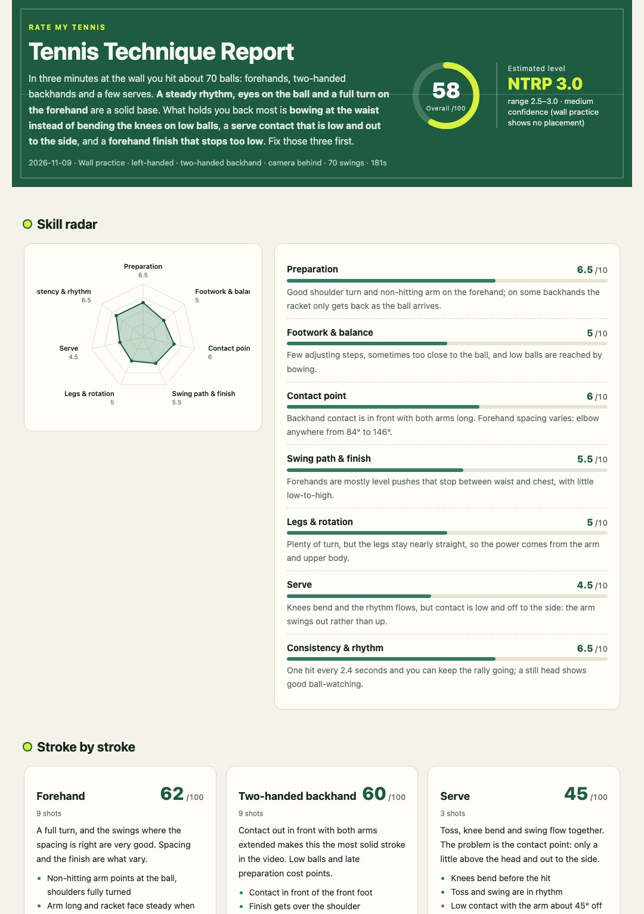
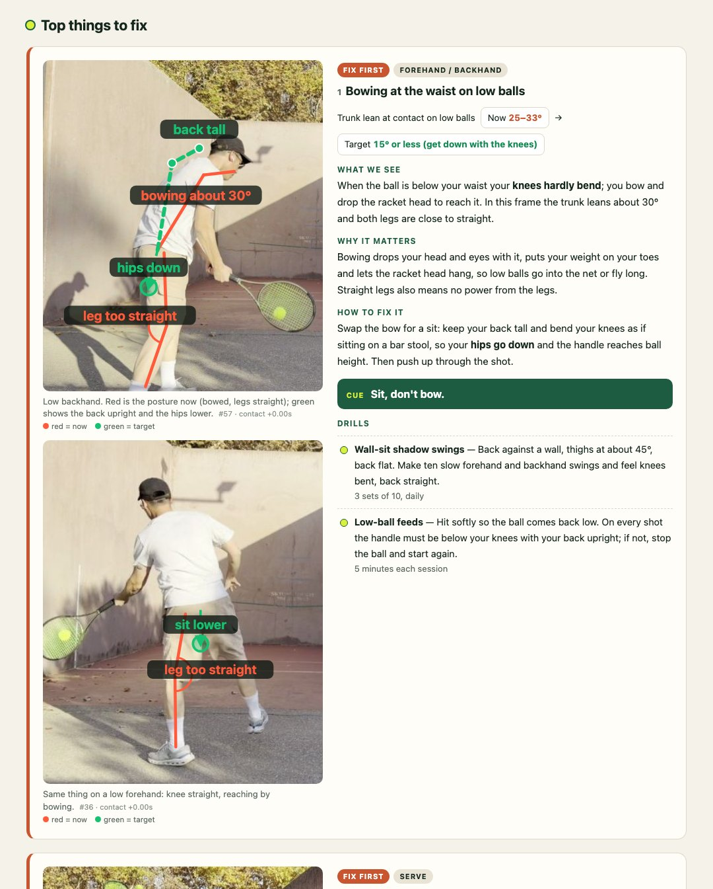

# Rate My Tennis 🎾

An open-source **agent skill** that turns a phone video of your tennis into an illustrated coaching report.

Upload a video of yourself hitting — against a wall, in a rally, in a match, or serving — to an AI assistant that
has this skill, and get back:

- an **overall score**, a **skill radar** and an **estimated NTRP level**
- a rating for each stroke it saw (forehand, backhand, serve, …)
- what you already **do well**, shown on your own frames
- the **3–5 things most worth fixing**, each drawn on your own body: red = what you do now, green = what to do
  instead, **animated** from one to the other
- for every fix: what we see, why it matters, how to fix it, a short **cue**, and **drills** with a dose
- **slow-motion scrubbers** of your swings, a training plan, and the measured numbers
- **progress tracking**: send your next video together with the small `tennis-progress.json` and the report shows
  what changed



Each fix is drawn on your own frames, red for now and green for the target, and animates between the two:



**Example reports** (real output from a three-minute wall-practice video; download the HTML and open it in a
browser): [English](docs/examples/wall-practice-en/report.html) ·
[中文](docs/examples/wall-practice-zh/report.html). The `report.json` beside each one is what the assistant wrote.

The report is a single self-contained HTML file (works offline, prints to PDF). Reports are written in the
language you talk to the assistant in (English and Chinese labels are built in).

[中文说明见下方](#中文说明)

## How it works

```
video ──► analyze_video.py ──► overview + filmstrips + metrics ──► the AI coach looks, labels, diagnoses
                                                                        │
              report.html ◄── build_report.py ◄── report.json ◄─────────┘
```

1. **`analyze_video.py`** finds every swing (racket-hand speed, confirmed by the impact *sound*), runs a pose
   model on a zoomed crop of the player, measures joint angles, contact height, stance, trunk lean, finish
   height…, and writes a six-phase filmstrip per swing.
2. **The assistant** looks at the frames like a coach, using the checkpoints, fault catalogue and scoring anchors
   in `references/`. Numbers support what it sees; they never replace looking.
3. **`build_report.py`** renders the findings: annotations are described by body-part names
   (`"rotate the left arm 30° up about the shoulder"`), so the drawing lands on the player and animates.
4. The assistant **checks every annotated picture** before handing over the report.

Everything runs locally in the assistant's code sandbox; the video is not sent to any other service.

## Install

### Claude Code (one line)

```
/plugin install rate-my-tennis --marketplace dukesky/rate-my-tennis-skill
```

(Claude Code 2.1.275 or later. On older versions: `/plugin marketplace add dukesky/rate-my-tennis-skill`, then
`/plugin install rate-my-tennis@rate-my-tennis`.) Or simply give Claude Code this repository's link and ask it
to install the skill.

Then point it at a video: *"rate my tennis: ~/Videos/forehand.mov"*.

### Claude apps (claude.ai, desktop, mobile)

Chat apps cannot install a skill from a link. Download **`rate-my-tennis.zip`** from the
[latest release](https://github.com/dukesky/rate-my-tennis-skill/releases/latest) and upload it under
Settings → Capabilities → Skills (code execution must be on). Then attach a video and say *"rate my tennis"*.

### ChatGPT

ChatGPT cannot install it from a link either. Download **`rate-my-tennis-chatgpt.zip`** from the
[latest release](https://github.com/dukesky/rate-my-tennis-skill/releases/latest), unzip it, create a Custom GPT
(or a Project) with **Code Interpreter** enabled, paste the contents of `INSTRUCTIONS-paste-into-GPT.md` into
Instructions, and upload the remaining files as Knowledge. Once built, a Custom GPT can be shared by link so
others do not have to set anything up.

ChatGPT's sandbox has no internet, so the `mediapipe` pose model usually cannot be installed there. The skill
then runs in **motion-only mode**: the assistant picks the swings from a contact sheet by eye and annotates by
coordinates. You still get the full report, without measured angles and with somewhat rougher overlays.

### Other agents

The skill follows the open [Agent Skills](https://agentskills.io) layout (`SKILL.md` + `scripts/` + `references/`),
so any agent that can read a skill folder and run Python can use it (e.g. Codex CLI, Gemini CLI: copy
`plugins/rate-my-tennis/skills/rate-my-tennis/` into that tool's skills directory).

### Run it by hand

```bash
pip install mediapipe opencv-python-headless numpy pillow
python plugins/rate-my-tennis/skills/rate-my-tennis/scripts/analyze_video.py my_video.mov --out out
# ... write out/report.json (see references/report-schema.md) ...
python plugins/rate-my-tennis/skills/rate-my-tennis/scripts/build_report.py out/report.json --analysis out --out out/report.html
```

## Recording tips

Tripod or fence mount, landscape, whole body in frame, **behind the player** (add a side-on clip if you can),
60 fps if available, sound on, 1–3 minutes, 8–10 repetitions of each stroke. Large files: trim or export at 720p.
Full guide: [`references/recording-guide.md`](plugins/rate-my-tennis/skills/rate-my-tennis/references/recording-guide.md).

## Limits — please read

- One camera, 30–60 fps: angles are **estimates** (about ±10° for elbows and knees, worse for rotation, and
  worse still for limbs hidden from the camera). The skill tells the assistant to trust its eyes over the numbers.
- The NTRP level is an estimate from technique; real ratings come from match results.
- One player at a time (use `--roi` to select who).
- An AI report does not replace a coach who can watch you live, and it is not medical advice.

## Repository layout

```
.claude-plugin/marketplace.json     Claude Code marketplace manifest
plugins/rate-my-tennis/
  .claude-plugin/plugin.json        plugin manifest
  skills/rate-my-tennis/            the skill itself:
  SKILL.md                    workflow the assistant follows
  scripts/analyze_video.py    video -> swings, filmstrips, metrics
  scripts/summarize.py        per-stroke averages using the coach's labels
  scripts/peek.py             one frame, full size, with a coordinate grid
  scripts/build_report.py     report.json -> report.html (+ annotated stills, progress file)
  references/checkpoints.md   what good looks like, common faults, metric ranges, drills
  references/scoring.md       dimension anchors, stroke scores, NTRP mapping
  references/report-schema.md report.json + annotation marks
  references/recording-guide.md
  assets/pose_landmarker_full.task   MediaPipe pose model (Apache-2.0)
chatgpt/instructions.md       Custom GPT / Project instructions
scripts/package.sh            builds dist/
```

## Contributing

Ideas that would help most: reference checkpoints for more strokes and levels, more languages, a pose backend
for sandboxes without MediaPipe, ball and racket tracking, doubles/match-play analysis. Issues and PRs welcome.

MIT licensed. The bundled pose model is © Google, Apache-2.0 (see [NOTICE](NOTICE)).

---

## 中文说明

**Rate My Tennis** 是一个开源的 AI 技能（skill）：把你打网球的手机视频（对墙、对拉、比赛、发球都可以）交给装了这个
skill 的 AI 助手，它会像教练一样看完视频，给你一份图文并茂的报告：

- **综合评分**、**能力雷达图**、**NTRP 水平估计**
- 每项技术（正手、反拍、发球……）的单独评分
- 你**已经做得好的地方**（用你自己的画面指出来）
- **最值得优先改的 3–5 个问题**：直接画在你自己的身体上——红色是现在的动作，绿色是应该做到的位置，并且会**动态演示**
  从红到绿怎么变
- 每个问题都有：看到了什么、为什么重要、怎么改、一句**口诀**、带次数的**练习方法**
- 你的挥拍**慢动作**（可拖动逐帧看）、训练计划、测量数据
- **进步追踪**：下次把新视频和上次生成的 `tennis-progress.json` 一起上传，报告会显示各项分数的变化

**样例报告**（一段三分钟对墙练习视频的真实输出，下载 HTML 后用浏览器打开）：[中文](docs/examples/wall-practice-zh/report.html) · [English](docs/examples/wall-practice-en/report.html)。

报告是一个独立的 HTML 文件，可离线打开、可打印成 PDF。你用什么语言和助手说话，报告就用什么语言。

**安装**：
- Claude Code：一行命令 `/plugin install rate-my-tennis --marketplace dukesky/rate-my-tennis-skill`，或者直接把本仓库链接发给它让它安装。
- Claude 聊天应用：不能通过链接安装。从 [最新 Release](https://github.com/dukesky/rate-my-tennis-skill/releases/latest) 下载
  `rate-my-tennis.zip`，在 Settings → Capabilities → Skills 上传（需开启代码执行）。
- ChatGPT：同样不能通过链接安装。下载 `rate-my-tennis-chatgpt.zip` 解压，新建 Custom GPT 或 Project，开启 Code Interpreter，
  把 `INSTRUCTIONS-paste-into-GPT.md` 的内容粘贴到 Instructions，其余文件作为 Knowledge 上传。（ChatGPT 沙盒通常装不了姿态模型，
  会自动降级为“纯目测模式”，仍能出完整报告，但没有角度数据。）

**录像建议**：手机固定、横屏、全身入镜、从身后拍（有条件再加一段侧面）、尽量 60 帧、保留声音、1–3 分钟、每种击球 8–10 次。

**局限**：单机位估计的角度有误差（约 ±10°），NTRP 只是基于动作的估计；AI 报告不能替代现场教练，也不是医疗建议。
